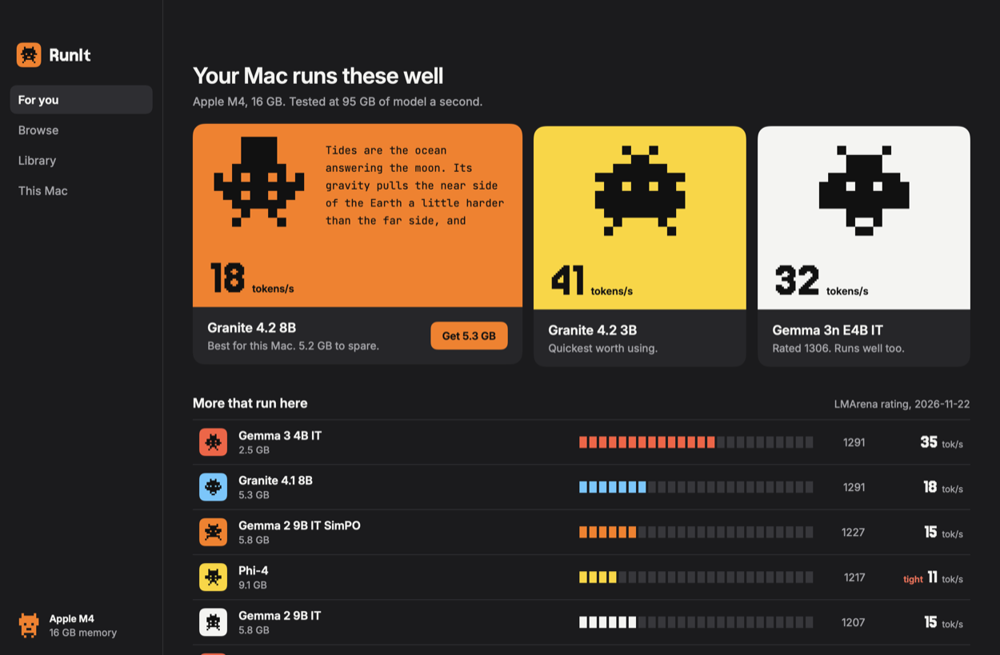
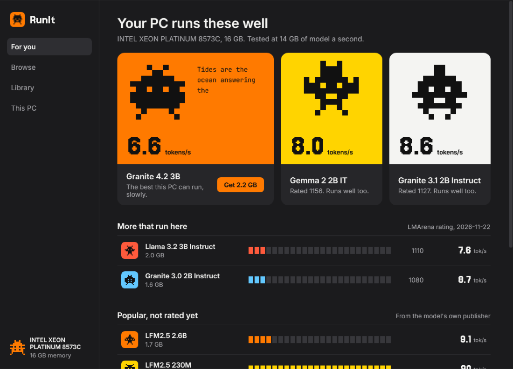

# RunIt

**Find out which open AI models your computer runs well, and how fast, before you download one.**

macOS 14 or newer:

```bash
curl -fsSL https://raw.githubusercontent.com/burhankhatri/RunIt/main/install.sh | sh
```

Windows 10 or 11, in PowerShell:

```powershell
irm https://raw.githubusercontent.com/burhankhatri/RunIt/main/install.ps1 | iex
```





## What it does

1. **Tests your computer with the real engine.** RunIt writes test models with random weights to your disk and times [llama.cpp](https://github.com/ggml-org/llama.cpp) on them, on your graphics processor and your processor. It needs no download and takes a minute or two.
2. **Predicts any model from its file.** It reads the first few kilobytes of a model on [Hugging Bay](https://huggingbay.xyz), works out how many bytes each token touches, and applies the speed curve it fitted to your machine.
3. **Suggests models worth running.** Ratings come from [LMArena](https://huggingface.co/datasets/lmarena-ai/leaderboard-dataset) (CC BY 4.0), where people compare answers blind. A fine-tune never borrows its parent's rating, and unrated models are listed apart.
4. **Lets you feel the speed.** Each model's page types a sample at exactly its predicted speed, beside its own pixel creature.
5. **Downloads anything on Hugging Bay**, resumable and checked against SHA-256.
6. **Shows its own error.** After a download it times the real model and puts the result beside the prediction. You can chat with it there too, offline.

Nothing about your computer is sent anywhere.

## How close is it?

On an M4 MacBook Air: within 8% for two ordinary models, 17% fast for a mixture of experts. Heat can slow a fanless laptop several times over, and RunIt says so when it sees it. [Numbers and limits](docs/accuracy.md).

## How it is built

A Rust core, a SwiftUI app and a C#/WPF app over a small C interface. See [docs/architecture.md](docs/architecture.md) and [testing.md](testing.md). The `runit-cli` program inside each app does everything without a window.

```bash
scripts/build-macos.sh
```

```powershell
scripts\build-windows.ps1
```

## Credits

Models and files: Hugging Bay, which RunIt is not affiliated with. Engine: llama.cpp (MIT). Ratings: LMArena (CC BY 4.0). Type: Inter, JetBrains Mono and Jersey 15 (SIL OFL), renamed, cut to static files and subset to Latin. RunIt is [MIT licensed](LICENSE).
